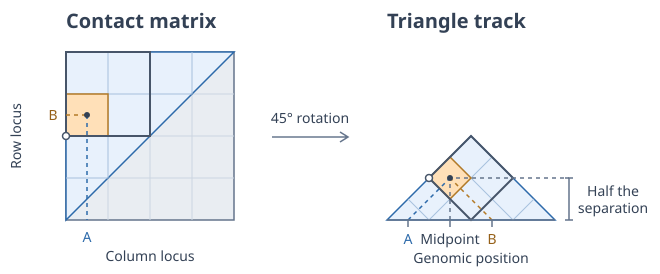

# Raster

The raster mark draws one regular grid of cells per data record. Each record is
a **tile**. Use tiles for dense data such as contact maps, sequence alignments,
or decoded images.

EXAMPLE examples/docs/grammar/mark/raster/raster-mark.json height=190

## Tile format

The example above uses this datum as its sole `data.values` entry.

```json
{
  "dimensions": {
    "column": { "origin": 10, "step": 2, "count": 3 },
    "row": { "origin": 0, "step": 1, "count": 2 }
  },
  "fields": { "value": [1, 2, 3, 4, 5, 6] }
}
```

The record's `dimensions` object describes each grid axis by name.

| Property | Meaning                                                  |
| -------- | -------------------------------------------------------- |
| `origin` | The first cell edge in data coordinates                  |
| `step`   | The positive spacing between cell edges in data units    |
| `count`  | The positive integer number of cells along the dimension |

Cell `i` starts at `origin + i * step` and ends at `origin + (i + 1) * step`,
with indices starting at zero. In the example, `column` covers `[10, 12)`,
`[12, 14)`, and `[14, 16)`. Locus dimensions use
[linearized genomic coordinates](../genomic-coordinates.md). A locus dimension
with `step: 1000` gives cells that cover 1 kb each.

Put cell values in named arrays under `fields`. Each array has one entry per
cell, in row-major order. For a tile with three columns and two rows, the first
three entries are the first row and the next three are the second.

For categorical cells, use an array of labels such as `["exon", "intron"]` or
numeric codes such as `[0, 1]`. A string is shorthand for an array of
single-character categories. For example, `"ACTG-"` represents
`["A", "C", "T", "G", "-"]`, with one base or gap per cell.

## Channels

Bind `x` and `y` to named grid dimensions using `dimension`. The mark derives
the cell edges from the tile. Grid dimensions support linear, index, and locus
scales with two domain endpoints. Use unclamped, unrounded scales and leave
padding and grouping gaps off index and locus scales.

The `color` channel's `field` names a cell field under `fields`. Quantitative
fields use a numeric color scale. Categorical fields use an ordinal color scale
with an explicit domain of category labels or codes.

For decoded images, set `color.scale` to `null` and supply one packed RGBA8 value
per cell in `0xAABBGGRR` order. Use straight alpha and write the packed integers
in decimal in JSON. In JavaScript, numeric cell fields can use `Float32Array`,
and packed images can use `Uint32Array`.

One cell field can drive either `color` or `opacity`. A raster with a fixed
color can encode signal intensity as `opacity` using a quantitative field. A
linear scale can have multiple matching domain and range stops. Log, power,
square-root, and symlog scales use two stops. With `opacity.scale` set to
`null`, values in `[0, 1]` are used directly. Both channels support
[cell-level selection conditions](../conditional-encoding.md#raster-cells).

Hovering over a cell shows its values and tile attributes. Packed RGBA8 images
skip picking by default. `mark.tooltip: { "handler": "default" }` enables image
tooltips, and `mark.tooltip: null` disables picking.

## Properties

SCHEMA RasterProps

## Examples

### Sequence strips

For a horizontal strip, bind `x` to a grid dimension and `y` to a categorical
field on a band scale. Swap the axes for vertical strips. In this example, the
top-level `sequence` field places the strip in a band, and `fields.base` supplies
the categorical value for each cell.

EXAMPLE examples/docs/grammar/mark/raster/sequence-strips.json height=135

### Rectangular contact map

As you pan and zoom, the map loads tiles at the appropriate resolution through
the [HiGlass data source](../data/lazy.md#higlass). The `column` and `row`
dimensions map to `x` and `y` on two locus scales. The logarithmic color scale
adapts to cells in the current viewport.

EXAMPLE examples/docs/grammar/data/lazy/higlass-contact-map.json height=400 spechidden

!!! disclaimer ""

    This example loads raster tiles from [higlass.io](https://higlass.io) for the
    hg19 GM12878 MboI contact map (all replicates) from
    [Rao et al. (2014)](https://pmc.ncbi.nlm.nih.gov/articles/PMC5635824/).

### Triangle tracks

A raster with a [triangle projection](../projection.md#triangle-projection)
draws one half of a contact matrix against a single genomic axis.



Bind the column dimension to `x` and the row dimension to `y`, then set
`"projection": "triangle"` on the raster's unit view or its enclosing layer.
Annotations can [share the projection](../projection.md#layered-views)
using their own matrix coordinates.

The [HiGlass data source](../data/lazy.md#triangle-track) loads tiles for the
visible part of the track.

EXAMPLE examples/docs/grammar/data/lazy/higlass-triangle-track.json height=210 spechidden

!!! disclaimer ""

    This track uses the same GM12878 MboI raster tiles from
    [higlass.io](https://higlass.io) as the rectangular map above.

#### Tile placement

A tile's `column` and `row` origins locate one corner in the original matrix,
marked by the hollow dot in the figure. The same midpoint and distance rule
places that corner in the track. For example, origins at 20 Mb and 30 Mb put
the corner above 25 Mb, at a height equal to the width of 5 Mb on the locus
scale.

Each dimension ends at `origin + step * count`. The mark projects all four
corners from the starts and ends of the two dimensions. A square tile
becomes a diamond, as shown by the dark outline. Tiles that cross the matrix
diagonal are clipped at the baseline. The top of the track also clips tiles,
so zooming in shows a shorter range of contact distances at the same height.

Omit the color scale's `domain` to infer it from the loaded tiles.
