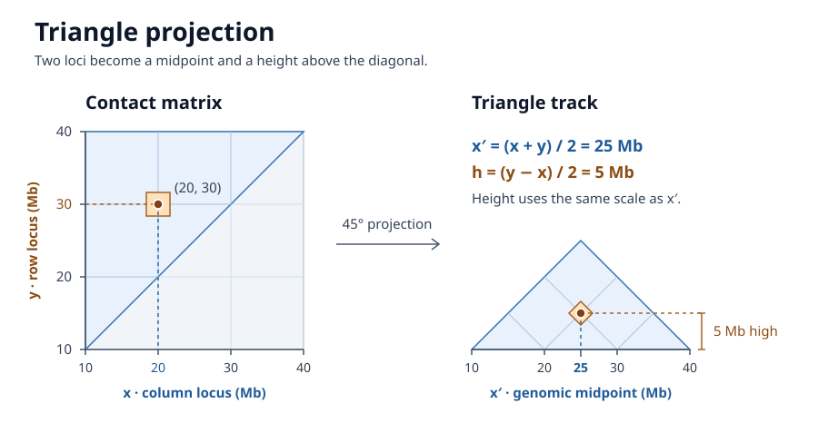

# Projection

A projection determines how a view places positions encoded by `x` and `y`. Set
`projection` on a [unit view](index.md#unit-views) to project one mark or on a
[layered view](composition/layer.md) to project its layers together. The setting
is fixed for the specification. Omit it for ordinary Cartesian coordinates or
set it to `null` to opt out of an inherited projection.

## Triangle projection

Triangle projection is designed for rotated contact matrices such as Hi-C maps.
Set `"projection": "triangle"` to display one half of the matrix as a 45° track.
Bind `x` to the column coordinate and `y` to the row coordinate. The horizontal
axis shows their midpoint. The distance from the baseline is half their
separation at the x scale. The matrix diagonal becomes the baseline, and
contacts with `y < x` fall outside the plot and are clipped.



Both inputs use the view's shared x scale. Use an unclamped, unrounded linear
scale or an unpadded index or locus scale without gaps. Only x has an axis and
supports pan and zoom. The plot height sets the visible separation range. Index
and locus midpoints use the usual rounding to whole positions.

!!! note "How the projection is applied"

    GenomeSpy projects raster tiles in the renderer. For other supported marks,
    it projects the anchors or endpoints and derives a vertical scale from the
    current x domain and plot dimensions. This keeps annotations aligned with
    the raster during zoom and resize.

### Downward-facing tracks

Set `"projection": { "type": "triangle", "direction": "down" }` to put the
baseline at the top of the plot. The same contacts and annotations extend
downward from it. The shorthand `"projection": "triangle"` places the baseline
at the bottom.

To compare two contact maps face to face, put an upward-facing view above a
downward-facing view in a `vconcat` with a shared x scale. Both maps then pan
and zoom together.

### Unit views

Place `projection` alongside `mark` and `encoding`. This unit view places one
point on the triangle track.

```json
{
  "projection": "triangle",
  "data": { "values": [{ "column": 20, "row": 30 }] },
  "mark": "point",
  "encoding": {
    "x": {
      "field": "column",
      "type": "quantitative",
      "scale": { "domain": [10, 40], "zoom": true }
    },
    "y": { "field": "row", "type": "quantitative" }
  }
}
```

### Layered views

Declare `projection` once alongside `layer`. Child marks keep their matrix
coordinates and can inherit shared bindings from the layer.

```json
{
  "projection": "triangle",
  "data": { "values": [{ "column": 20, "row": 30 }] },
  "encoding": {
    "x": {
      "field": "column",
      "type": "quantitative",
      "scale": { "domain": [10, 40], "zoom": true }
    },
    "y": { "field": "row", "type": "quantitative" }
  },
  "layer": [
    { "mark": "point" },
    { "mark": { "type": "text", "text": "Contact", "dx": 8 } }
  ]
}
```

A child view can set `"projection": null` to keep an overlay in the rectangular
frame. Cartesian y scale and axis settings apply when the projection is off.

A Hi-C raster shares its projection with contact markers, labels, and guides in
the [SELL Promoter–Enhancer Contact example](../examples/genomic-data/sell-promoter-enhancer.md).

### Marks and interactions

| Marks                   | Coordinate bindings                                                                       |
| ----------------------- | ----------------------------------------------------------------------------------------- |
| `raster`                | Bind the column and row [grid dimensions](mark/raster.md#triangle-tracks) to `x` and `y`. |
| `point`, `text`         | Bind the matrix coordinates of the anchor to `x` and `y`.                                 |
| `rule`, `arrow`, `link` | Bind the first endpoint to `x` and `y` and the second to `x2` and `y2`.                   |
| `rect`, `tick`          | Use `projection: null` for frame overlays.                                                |

Segment marks use their usual stroke, arrowhead, or curve between projected
endpoints. For raster cells, interval conditions apply to color in triangle
views. Cartesian views also support positional cell brushes.
