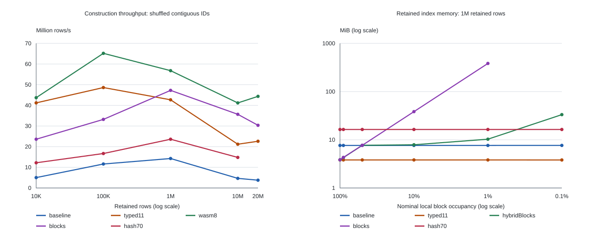

# GenomeSpy unique-ID indexing study

Historical study measured on 14 October 2026, before the proposed production
optimization was applied. All statements about unchanged production code and
release impact below describe that research phase. The original sorter is now
frozen in `baselineRadixSort.js`, preserving these results' reference point;
the suite also exposes the current implementation as `production`. The
reproducible suite, raw samples and CSV summaries are in this directory; see
[README.md](README.md) for commands and measurement definitions.

This suite and its results are archived in an intermediate commit of the
optimization PR and removed in the following commit. The PR links to that
snapshot; its final diff contains only the optimization, regression tests, and
release note. The production and value-sort follow-ups below record the later
implementation and validation.

<!-- headline:start -->

**The smallest broadly applicable change supported by these measurements is a
Uint32 permutation/scratch radix sorter with 11-bit digits, preserving stable
ordering, safe-integer keys and the sorted-input early exit.** On this Node
build, 10M shuffled rows took 2148.1 ms with the unchanged baseline
and 472.0 ms with typed11 (4.55× construction speedup);
retained index memory fell from 76.3
to 38.1 MiB. Dense block
lookup built in 280.4 ms, and scalar Wasm in 242.9 ms.
Neither is a universal replacement: block memory depends strongly on density,
and Wasm needs extra linear memory and an asset/loader integration.
The recommendation is a proposal only; no production implementation changed.
<!-- headline:end -->

## Existing mechanism and supported values

`IdentifierTransform` reserves blocks of 10,000 IDs in a module-global array.
Block zero is reserved for no pick. Each transform remembers its blocks and
reuses them after `reset()`. Other transforms can reserve intervening blocks,
so a stream is sequential within a block but need not be globally contiguous.
Reservations are neither scoped to an instance nor released on disposal.

`Collector.complete()` groups and sorts rows before building the index. It
concatenates IDs in the **current facet iteration order**, using `ids.push`,
and sorts a permutation of physical positions. The unchanged baseline uses
4-bit stable LSD radix passes, ordinary arrays, a maximum scan, and an early
sortedness check. It never rearranges collector rows. Its lookup runs d3
`bisector.left` over the permutation; each comparator resolves the physical
position by bisecting facet starts, accessing the facet Map, and reading the
datum's ID. It constructs those bisectors and closures on each lookup.
Construction is approximately O(n d); full lookup is O(log n log f), where f
is facet count. All measured datasets have eight facets.

ID allocation order cannot be used as a physical position: filtering, grouping,
sorting and independent collectors change that relationship. Every direct or
hash index here is built by walking the current collector rows.

There are several distinct range limits:

- CPU radix sorting and collector lookup work with nonnegative safe integer
  Numbers through `Number.MAX_SAFE_INTEGER` (2^53 - 1). There is no validation
  or declared maximum in these production functions. Negative, fractional,
  NaN, or imprecise integers are outside the unsigned-integer input contract.
  Existing radix tests already generate values up to 10 billion. This suite
  verifies signed/unsigned 32-bit boundaries, larger powers of two and the
  upper safe-integer boundary without truncating keys to Uint32.
- The allocator has a lower structural ceiling: JavaScript array indexes end
  at 2^32 - 2. Its last distinct array-index block would be 4,294,967,294,
  ending at ID 42,949,672,949,999. At array length 2^32 - 1, writing the next
  block becomes a non-index property, so length stops advancing and reservations
  would repeat. This is an inferred structural failure boundary, not a tested
  allocation or an enforced supported capacity. Practical memory limits arrive
  much earlier. The allocator still demonstrably does not justify 32-bit keys.
- WebGL uploads unique IDs through `Uint32Array` to a GLSL `uint`, then encodes
  picking into four bytes. GPU picking cannot distinguish IDs above 2^32 - 1;
  ID zero means no pick. CPU indexing correctness above 32 bits does not fix
  that separate rendering limitation.
- Candidate positions use Uint32 and direct/hash slots encode position + 1,
  reserving zero for absence. Row count is explicitly limited to 2^32 - 1.
  This is also the ordinary Array length limit. Wasm has an additional 2 GiB
  configured linear-memory limit; this suite permits at most 20M rows.

The identifier normally assigns distinct IDs. The collector nevertheless
accepts duplicates: stable radix sorting plus `bisector.left` returns the first
matching datum in current flattened facet order. Candidates preserve that
behavior. Cloning transforms can copy ID fields, so changing to last-wins would
be an observable difference. Tests cover duplicates in separate facets,
reordering, filtered subsets, independent collectors, rebuilding/reset, empty
and singleton data, gaps, and actual interleaved IdentifierTransform streams.

Relevant production sources: [radixSort.js](../../src/utils/radixSort.js),
[collector.js](../../src/data/collector.js),
[identifier.js](../../src/data/transforms/identifier.js),
[WebGL attribute types](../../src/rendering/webgl/gl/glslScaleGenerator.js),
[picking shader](../../src/rendering/webgl/gl/includes/picking.vertex.glsl),
[interaction lookup caller](../../src/genomeSpy/interactionController.js).

## Candidates and complexity

Here d is the number of digits, B the number of occupied blocks, K = 10,000,
and k_b the rows in a sparse block. Payloads below exclude the input dataset
and JS container overhead. Ordinary-array estimates describe this Node build;
typed-array sizes are exact. All radix candidates retain only the permutation.

| Candidate                 | Construction                                              | Raw lookup                             | Retained payload                                | Construction storage                                            |
| ------------------------- | --------------------------------------------------------- | -------------------------------------- | ----------------------------------------------- | --------------------------------------------------------------- |
| baseline                  | O(n d), 4-bit                                             | O(log n log f)                         | measured about 8n bytes                         | IDs + two ordinary permutations; nominal 24n                    |
| array4 / array8           | O(n d), controlled common implementation                  | O(log n log f)                         | about 8n                                        | nominal 24n + bucket counters                                   |
| typed4 / typed8 / typed11 | O(n d), 16 / 256 / 2048 buckets                           | O(log n log f)                         | 4n                                              | IDs + two Uint32 permutations; nominal 16n + counters           |
| pairs8                    | O(n d), moving separate Float64 keys and Uint32 positions | O(log n log f)                         | 4n                                              | nominal 32n including input IDs and both key/position buffers   |
| interleaved8              | O(n d), Float64 key/position pairs                        | O(log n log f)                         | 4n after extraction                             | nominal 44n including IDs, scratch pairs, extracted permutation |
| blocks                    | O(n + B K) allocation                                     | expected O(1)                          | 4 B K + directory                               | zeroed dense position arrays; no ID materialization             |
| hybridBlocks              | O(n + sum k_b log k_b)                                    | expected O(1) dense, O(log k_b) sparse | sparse pairs 8n, or dense 4 B K, plus directory | temporary JS pairs/order arrays and final blocks                |
| hash50 / hash70 / hash85  | expected O(n), worst O(n^2)                               | expected O(1), worst O(n)              | 12 ceil(n / load)                               | Float64 keys + Uint32 position/sentinel slots                   |
| wasm8                     | O(n d), scalar uint64 key/Uint32 position LSD             | O(log n log f) after copy out          | 4n                                              | 24n linear memory + JS IDs + 4n extracted output                |
| map                       | expected O(n)                                             | expected O(1)                          | measured, implementation dependent              | ordinary Map; reference capped at 1M                            |

Direct/hash **full** lookup additionally resolves a physical position through
the facet directory. Sorted lookup uses the actual Collector procedure, not a
binary search over a conveniently retained sorted key array. This procedure is
copied into the standalone adapter and cross-checked with the real Collector.

`array4` versus `typed4`, and `array8` versus `typed8`, isolate index/scratch
buffer representation. `typed4` versus `typed8` versus `typed11` isolate radix
width in that same implementation. Comparing the baseline to `array4` also
exposes common-loop changes: combined maximum/sortedness scan, explicit index
initialization, typed counters, and forward stable scatter. Thus the entire
baseline-to-typed8 improvement must not be attributed to typed arrays alone.

Hash capacity is `ceil(n / targetLoad)` rather than rounded to a power of two,
so requested load factors remain distinct. A mixed 64-bit hash incorporates
both low and high words; collisions use linear probing, equality uses exact
Number keys, and zero position slots terminate unsuccessful searches.
Hybrid blocks promote at 25% occupancy, where two Uint32 values per retained
row cost the same payload as 10K direct slots. Sparse offsets are sorted with
first-occurrence precedence. This is one measured hybrid, not an optimized
or exhaustive search over hybrid designs.

## Workloads and methodology

<!-- environment:start -->

Apple M5, 32 GiB RAM,
darwin 25.5.0 arm64; Node v26.8.1,
V8 14.6.202.34-node.28. Source commit: `7a023b7d375a0a851b4de70c848fe726ac421634`.
The raw metadata includes the unchanged baseline SHA-256. Chromium
153.0.8010.12 was measured separately, headless, with exposed GC and a
fresh page per cell. All runs use seed 20261014. Only Chromium was available;
Firefox and Safari were not measured. Browser memory was not measured.
<!-- environment:end -->

The main matrix contains 13 distributions at each of 10K, 100K, 1M and 10M
**retained** rows: contiguous sorted IDs; shuffled contiguous IDs; shuffled
10K blocks with six intervening unused blocks; Bernoulli retention at 90%,
50%, 10% and 1%; ten occupied offsets per distant block (0.1% occupancy);
four interleaved allocation streams; 0.1% random swaps in otherwise sorted
IDs; sorting by an independent random field; shuffled mixed 31-, 32- and
53-bit safe IDs; and unique pseudo-uniform 40-bit IDs. The last distribution
is intentionally artificial, to distinguish uniform keys from actual block
reservation behavior. Retention generates geometric gaps and preserves source
order, as a normal filter does. Randomized correctness tests additionally
combine filtering and arbitrary reordering.

Each cell uses its own process, four warmup datasets, three constructions,
explicit GC before construction, and GC after construction for retained
memory. Data generation and unrelated-field sorting are excluded; ID
materialization and all conversions/copies are included. Candidate/workload
order is deterministically shuffled within each size and workers run serially.
Natural construction GC is included in timings and recorded. Lookup batches
run for at least 8 ms, consume checksums, and use identical query inputs for
each candidate. Hit queries select random rows, miss queries are absent
**integers**, mixed is 50/50, same repeats an ID, and nearby cycles through
64 numeric neighbors. Nearby can include misses in filtered/sparse data.

Tables report medians; MAD is median absolute deviation, not a confidence
interval. Three samples are adequate for identifying large differences here,
not for ranking small percentage differences. Warmup cannot eliminate all
tiering, GC, thermal or shared-desktop noise. Allocation checkpoints add a
small cost to Node construction timing; browser construction has no memory
checkpoints. Browser and Node measurements therefore also differ in harness
instrumentation, V8 version and runtime configuration.

Memory deltas count `heapUsed + arrayBuffers`, avoiding double counting
`external`. This Node build omits Wasm linear memory from both backing-store
counters; the Wasm accounted-peak column adds its explicit linear allocation.
Retained measurements exclude temporary IDs and sorting scratch after GC.
Sampled allocation peaks are **lower bounds**, not an allocator trace or exact
peak-live measurement. RSS high-water includes rows, warmup and setup; it is
reported separately in raw data. Nominal payload bounds exclude ordinary-array
growth capacity, dead backing stores awaiting GC, container headers and GC
metadata. At small sizes, GC/tiering noise can dominate memory deltas.

<!-- coverage:start -->

759 of 780 main Node cells completed;
21 cells were explicitly skipped by the resource policy.
6 selected 20M-row cells,
three additional 262,144-query cells, and
46 Chromium cells completed, followed by two targeted seven-trial
radix-width reruns. There were 0 recorded failures.
Map is intentionally capped at 1M. Dense block directories at sufficiently low
occupancy exceed the 768 MiB projected index budget; the largest sparse hybrid
cases also exceed it. The 20M shortlist used a 1536 MiB projected index budget
after the 10M run demonstrated practical process memory. Larger than 20M and
Map capacity limits were not tested. No speedup is inferred for skipped cells.

| Candidate    | Skipped sizes / distributions                                                                                                                                                               | Reason                      |
| ------------ | ------------------------------------------------------------------------------------------------------------------------------------------------------------------------------------------- | --------------------------- |
| blocks       | 0.1M uniform; 1M sparseBlocks; 1M uniform; 10M retain1; 10M sparseBlocks; 10M uniform                                                                                                       | projected allocation budget |
| map          | 10M shuffled; 10M mostlySorted; 10M streams; 10M largeIntegers; 10M sparseBlocks; 10M uniform; 10M retain1; 10M retain10; 10M retain90; 10M sorted; 10M retain50; 10M unrelated; 10M blocks | limited reference           |
| hybridBlocks | 10M sparseBlocks; 10M uniform                                                                                                                                                               | projected allocation budget |

<!-- coverage:end -->

## Construction versus size

<!-- construction:start -->

Shuffled contiguous IDs; construction milliseconds **median ± MAD**, including
ID extraction and conversions. — means the comparison was not run.

| Candidate    | 10K         | 100K         | 1M          | 10M            | 20M            |
| ------------ | ----------- | ------------ | ----------- | -------------- | -------------- |
| baseline     | 1.99 ± 0.01 | 8.62 ± 0.26  | 70.1 ± 6.9  | 2148.1 ± 28.2  | 5303.4 ± 2.3   |
| array4       | 0.58 ± 0.12 | 8.31 ± 3.80  | 66.9 ± 5.2  | 2821.9 ± 40.8  | —              |
| array8       | 0.23 ± 0.01 | 5.50 ± 3.55  | 49.6 ± 11.2 | 1595.2 ± 34.6  | —              |
| typed4       | 0.48 ± 0.02 | 4.82 ± 0.08  | 51.1 ± 2.3  | 2390.4 ± 107.6 | —              |
| typed8       | 0.25 ± 0.00 | 2.62 ± 0.25  | 28.0 ± 1.6  | 736.6 ± 12.8   | 1981.0 ± 140.6 |
| typed11      | 0.24 ± 0.01 | 2.06 ± 0.20  | 23.4 ± 1.7  | 472.0 ± 71.3   | 884.2 ± 144.6  |
| pairs8       | 0.45 ± 0.00 | 9.02 ± 4.86  | 42.9 ± 4.4  | 510.1 ± 40.0   | 1137.9 ± 47.9  |
| interleaved8 | 0.46 ± 0.02 | 5.87 ± 1.81  | 49.8 ± 5.9  | 575.8 ± 2.9    | —              |
| blocks       | 0.42 ± 0.00 | 3.01 ± 0.51  | 21.2 ± 1.0  | 280.4 ± 6.5    | 659.1 ± 1.5    |
| hybridBlocks | 2.12 ± 0.04 | 18.57 ± 0.75 | 169.8 ± 7.8 | 1722.5 ± 2.2   | —              |
| hash50       | 0.74 ± 0.01 | 5.58 ± 0.04  | 43.5 ± 4.4  | 514.7 ± 2.8    | —              |
| hash70       | 0.82 ± 0.01 | 5.99 ± 0.58  | 42.4 ± 1.8  | 676.1 ± 31.5   | —              |
| hash85       | 0.95 ± 0.04 | 5.64 ± 0.18  | 44.5 ± 0.9  | 737.4 ± 10.9   | —              |
| map          | 0.43 ± 0.00 | 3.72 ± 0.21  | 54.5 ± 5.3  | —              | —              |
| wasm8        | 0.23 ± 0.01 | 1.53 ± 0.16  | 17.6 ± 2.4  | 242.9 ± 8.6    | 450.9 ± 82.5   |

Construction throughput, million retained rows/second:

| Rows       | baseline | typed8 | typed11 | pairs8 | wasm8 | blocks |
| ---------- | -------- | ------ | ------- | ------ | ----- | ------ |
| 10,000     | 5.0      | 40.6   | 41.2    | 22.4   | 43.7  | 23.6   |
| 100,000    | 11.6     | 38.2   | 48.6    | 11.1   | 65.2  | 33.2   |
| 1,000,000  | 14.3     | 35.7   | 42.7    | 23.3   | 56.8  | 47.3   |
| 10,000,000 | 4.7      | 13.6   | 21.2    | 19.6   | 41.2  | 35.7   |
| 20,000,000 | 3.8      | 10.1   | 22.6    | 17.6   | 44.4  | 30.3   |

Selected 10M distribution comparisons, median construction ms:

| Distribution  | baseline | typed8 | typed11 | pairs8 | wasm8 | blocks | hash70 |
| ------------- | -------- | ------ | ------- | ------ | ----- | ------ | ------ |
| sorted        | 301.0    | 100.0  | 96.9    | 274.8  | 99.4  | 76.0   | 659.1  |
| shuffled      | 2148.1   | 736.6  | 472.0   | 510.1  | 242.9 | 280.4  | 676.1  |
| blocks        | 2497.8   | 945.0  | 463.9   | 536.6  | 205.0 | 263.1  | 642.1  |
| retain90      | 295.9    | 93.9   | 98.8    | 294.2  | 101.4 | 77.2   | 633.8  |
| retain50      | 298.7    | 97.6   | 122.7   | 273.6  | 99.9  | 79.3   | 634.8  |
| retain10      | 294.0    | 101.0  | 104.5   | 277.1  | 106.4 | 214.5  | 634.1  |
| retain1       | 309.1    | 110.1  | 101.3   | 276.7  | 122.1 | —      | 640.4  |
| sparseBlocks  | 3917.5   | 698.5  | 544.0   | 502.0  | 173.3 | —      | 684.0  |
| streams       | 1074.1   | 398.5  | 228.3   | 520.2  | 226.9 | 90.8   | 641.6  |
| mostlySorted  | 1099.0   | 509.7  | 215.6   | 522.8  | 268.0 | 87.6   | 712.7  |
| unrelated     | 2158.6   | 738.3  | 424.5   | 493.0  | 249.2 | 267.1  | 626.8  |
| largeIntegers | 5420.3   | 1642.3 | 633.0   | 575.2  | 254.9 | 405.9  | 743.0  |
| uniform       | 3816.0   | 602.5  | 511.6   | 517.6  | 198.0 | —      | 669.6  |

The sorted/retained-in-source-order workloads take the early exit; increasing
radix width does not help them. Baseline-to-typed improvements there come from
index initialization, buffer representation and combined scanning. Shuffled
large inputs reward fewer passes. Moving keys with positions adds bandwidth
and allocation at small sizes but avoids repeated random `ids[index]` reads
on large inputs. Interleaving stores positions as Float64, increasing scratch
traffic and requiring output extraction. Fixed 11-bit radix can reduce passes
further, but its 2048-bucket scatter and arithmetic digit crossing bit 31 are
a different cache/CPU trade-off; results do not justify adaptive dispatch. At 1M contiguous IDs, 11-bit radix
uses two passes versus three for 8-bit; at 10M both use three. That latter
time difference cannot be explained by pass count alone. Hardware cache/CPU
counters were not collected, so the locality explanations are interpretations
of the measured representation and scaling, not proven microarchitectural causes.

<!-- construction:end -->

## Memory versus size and density

<!-- memory:start -->

10M shuffled rows; MiB. Observed peaks count heap and backing stores; for Wasm
the accounted peak adds its explicit linear allocation, which this V8 version
omits. These are sampled allocation deltas, not exact live-allocation peaks.

| Candidate    | Retained | Observed/accounted peak | Logical peak payload | Process peak RSS (input included) |
| ------------ | -------- | ----------------------- | -------------------- | --------------------------------- |
| baseline     | 76.3     | 341.6                   | 228.9                | 1087.6                            |
| array4       | 76.3     | 341.6                   | 228.9                | 1080.3                            |
| array8       | 76.3     | 469.4                   | 228.9                | 1086.8                            |
| typed4       | 38.1     | 273.7                   | 152.6                | 1005.5                            |
| typed8       | 38.1     | 344.5                   | 152.6                | 1004.7                            |
| typed11      | 38.1     | 349.2                   | 152.6                | 1005.0                            |
| pairs8       | 38.1     | 346.7                   | 305.2                | 1161.5                            |
| interleaved8 | 38.2     | 457.2                   | 419.6                | 1275.3                            |
| blocks       | 38.4     | 55.5                    | 38.1                 | 648.0                             |
| hybridBlocks | 38.4     | 487.3                   | unmodeled            | 1181.7                            |
| hash50       | 228.9    | 232.3                   | 228.9                | 805.8                             |
| hash70       | 163.5    | 165.7                   | 163.5                | 743.3                             |
| hash85       | 134.6    | 138.6                   | 134.6                | 712.0                             |
| wasm8        | 38.1     | 575.8                   | 343.5                | 1202.2                            |

At 1M retained rows, memory versus ID density (MiB):

| Distribution  | baseline | typed8 | blocks | hybridBlocks | hash70 | map  |
| ------------- | -------- | ------ | ------ | ------------ | ------ | ---- |
| shuffled      | 7.6      | 3.8    | 3.8    | 3.8          | 16.4   | 28.0 |
| retain90      | 7.6      | 3.8    | 4.3    | 4.3          | 16.4   | 28.0 |
| retain50      | 7.6      | 3.8    | 7.7    | 7.7          | 16.4   | 28.0 |
| retain10      | 7.6      | 3.8    | 38.4   | 7.9          | 16.4   | 28.0 |
| retain1       | 7.6      | 3.8    | 383.5  | 10.3         | 16.4   | 28.0 |
| sparseBlocks  | 7.6      | 3.8    | —      | 33.3         | 16.4   | 41.4 |
| largeIntegers | 7.6      | 3.8    | 11.6   | 11.5         | 16.4   | 43.3 |

The typed permutation retains exactly 4 bytes per row independent of key
range or density. A dense block has 40,000 bytes even with one retained row:
its payload is 4/occupancy bytes per row, before directory overhead. Hybrid
blocks bound slot waste, but per-block Maps/objects/typed-array headers and
temporary pairs remain substantial for many sparse blocks. Dense blocks at
0.1% occupancy would require about 3.73 GiB per million rows in position
payload alone, so the large cases were skipped. Map memory also grows when
large Number keys require boxed values; no very-large-Map viability is claimed.

The nominal radix storage formulas understate allocation churn from `ids.push`
and ordinary-array growth: old backing stores can await GC while new ones are
allocated. Raw checkpoints and natural GC events record those effects.
Retained memory is the stronger, less noisy comparison here; precise allocator
peaks would require profiling beyond these checkpoints. In this matrix the
sampled typed11 peak is not lower than baseline, despite halving retained
storage; no peak-memory reduction is promised. Hybrid construction and Map
payload models are explicitly null/unmodeled in raw results; their actual
measured allocation deltas are retained.
<!-- memory:end -->

## Lookup and construction amortization

<!-- lookup:start -->

1M shuffled rows; nanoseconds/query. Full paths resolve the actual datum, and
raw direct/hash paths return its current physical position.

| Candidate    | Raw hit | Raw miss | Full hit | Full miss | Full mixed | Full same | Full nearby |
| ------------ | ------- | -------- | -------- | --------- | ---------- | --------- | ----------- |
| baseline     | 2067    | 559      | 1603     | 717       | 985        | 647       | 684         |
| typed8       | 2039    | 570      | 1663     | 750       | 1032       | 672       | 697         |
| typed11      | 2144    | 567      | 1850     | 751       | 1022       | 650       | 701         |
| pairs8       | 2053    | 584      | 1726     | 763       | 989        | 644       | 702         |
| wasm8        | 2216    | 564      | 2301     | 796       | 1294       | 670       | 710         |
| blocks       | 23      | 7        | 57       | 7         | 28         | 16        | 16          |
| hybridBlocks | 24      | 7        | 66       | 8         | 28         | 16        | 16          |
| hash50       | 19      | 13       | 58       | 18        | 25         | 13        | 15          |
| hash70       | 22      | 16       | 56       | 22        | 28         | 13        | 16          |
| hash85       | 23      | 37       | 65       | 36        | 34         | 19        | 19          |
| map          | 31      | 24       | 77       | 25        | 37         | 15        | 19          |

10M shuffled rows, full datum resolution (ns/query):

| Candidate | Hit  | Miss | Mixed | Same | Nearby |
| --------- | ---- | ---- | ----- | ---- | ------ |
| baseline  | 3187 | 849  | 1433  | 735  | 788    |
| typed8    | 3379 | 874  | 1646  | 742  | 805    |
| typed11   | 3345 | 872  | 1563  | 789  | 796    |
| pairs8    | 3357 | 867  | 1576  | 759  | 800    |
| wasm8     | 3213 | 929  | 1891  | 765  | 823    |
| blocks    | 90   | 8    | 36    | 18   | 18     |
| hash50    | 91   | 20   | 31    | 14   | 16     |
| hash70    | 83   | 24   | 32    | 14   | 18     |
| hash85    | 100  | 41   | 43    | 16   | 18     |

Permutation sort variants do not materially change lookup's algorithm: their
row/facet binary search is identical. Differences among those rows also reflect
JIT and measurement variability and should not be sold as lookup improvements.
Direct/hash indexes remove that repeated binary search. Higher hash occupancy
reduces memory but generally increases probing, especially for misses; this
implementation's modulo capacity and exact Float64 comparisons are included.
Local queries have different cache behavior from random queries. The current
per-query bisector/closure allocations remain in all sorted-candidate timings.

The default random batch contains 8192 IDs and is reused to reach the timer
minimum; it is a warm-working-set measurement, not a single cold pick. A
focused 10M-row rerun uses 262,144 queries (32 times as many), with these full
lookup medians (ns/query):

| Candidate | 8K hit | 262K hit | 8K mixed | 262K mixed |
| --------- | ------ | -------- | -------- | ---------- |
| typed11   | 3345   | 2844     | 1563     | 1791       |
| blocks    | 90     | 152      | 36       | 87         |
| hash70    | 83     | 136      | 32       | 97         |

This sensitivity check reinforces the broad lookup advantage of direct/hash
indexes, but changes the absolute cost. It does not establish cold-cache
latency; JIT and desktop noise also differ across runs. Raw and full timings
are independently warmed code paths, so subtracting them is not a reliable
measurement of facet-resolution overhead. The amortization estimates below
use the main matrix, and are conditional on its query mix/working set.
<!-- lookup:end -->

Fast lookup alone does not determine the right representation. The interaction
caller resolves hovered/picked IDs, potentially across several views; the code
does not establish a universal lookup count per collector. The break-even
calculation below is conditional on these measured workloads, rather than a
claim that all GenomeSpy sessions perform that many lookups.

<!-- amortization:start -->

Compare to typed11 using successful full lookups. Break-even queries are
`max(0, extra build ms) * 1e6 / saved ns per query`; memory costs still apply.
Zero means the alternative already built faster in that cell.

| Rows / distribution | Alternative  | Extra build ms | Saved ns/hit | Break-even hits |
| ------------------- | ------------ | -------------- | ------------ | --------------- |
| 1M sorted           | blocks       | 1.4            | 1511         | 919             |
| 1M sorted           | hash70       | 35.9           | 1513         | 23,709          |
| 1M shuffled         | blocks       | -2.3           | 1792         | 0               |
| 1M shuffled         | hash70       | 18.9           | 1794         | 10,563          |
| 10M sorted          | blocks       | -20.9          | 1925         | 0               |
| 10M sorted          | hash70       | 562.2          | 1923         | 292,353         |
| 10M shuffled        | blocks       | -191.6         | 3255         | 0               |
| 10M shuffled        | hash70       | 204.1          | 3262         | 62,573          |
| 1M retain1          | blocks       | 62.7           | 1162         | 53,962          |
| 1M retain1          | hash70       | 35.2           | 1177         | 29,891          |
| 1M retain1          | hybridBlocks | 40.4           | 1080         | 37,456          |

A collector with comparatively few picks should prioritize construction and
retained memory. These thresholds show when an O(1) index may pay for itself
in CPU time, but do not remove hash/block memory costs. Dense block lookup can
win both construction and queries on shuffled dense data; adopting it globally
still fails the sparse-memory requirement. The measured hybrid is especially
expensive to construct after random reordering and does not justify automatic
hybrid selection over a simpler general-purpose permutation.
<!-- amortization:end -->

## Browser and Wasm findings

<!-- browser:start -->

Chromium construction medians (ms), with the corresponding Node medians.
The browser includes all copies but excludes Node's memory checkpoint overhead.

| Rows / distribution | Candidate | Node   | Chromium |
| ------------------- | --------- | ------ | -------- |
| 1M sorted           | baseline  | 27.0   | 23.4     |
| 1M sorted           | typed8    | 7.7    | 5.9      |
| 1M sorted           | typed11   | 7.9    | 6.2      |
| 1M sorted           | pairs8    | 25.5   | 22.5     |
| 1M sorted           | wasm8     | 9.8    | 5.6      |
| 1M sorted           | blocks    | 9.3    | 7.4      |
| 1M sorted           | hash70    | 43.8   | 31.7     |
| 1M shuffled         | baseline  | 70.1   | 60.9     |
| 1M shuffled         | typed8    | 28.0   | 24.6     |
| 1M shuffled         | typed11   | 23.4   | 18.9     |
| 1M shuffled         | pairs8    | 42.9   | 39.8     |
| 1M shuffled         | wasm8     | 17.6   | 14.5     |
| 1M shuffled         | blocks    | 21.2   | 22.0     |
| 1M shuffled         | hash70    | 42.4   | 31.3     |
| 1M largeIntegers    | baseline  | 168.2  | 140.6    |
| 1M largeIntegers    | typed8    | 33.5   | 52.5     |
| 1M largeIntegers    | typed11   | 32.4   | 42.8     |
| 1M largeIntegers    | pairs8    | 54.1   | 57.2     |
| 1M largeIntegers    | wasm8     | 20.4   | 15.9     |
| 1M largeIntegers    | blocks    | 27.1   | 28.4     |
| 1M largeIntegers    | hash70    | 45.9   | 31.2     |
| 1M sparseBlocks     | baseline  | 121.5  | 104.4    |
| 1M sparseBlocks     | typed8    | 42.8   | 45.5     |
| 1M sparseBlocks     | typed11   | 34.3   | 44.3     |
| 1M sparseBlocks     | pairs8    | 67.0   | 57.0     |
| 1M sparseBlocks     | wasm8     | 16.9   | 14.7     |
| 1M sparseBlocks     | hash70    | 50.3   | 32.2     |
| 10M shuffled        | baseline  | 2148.1 | 1632.1   |
| 10M shuffled        | typed8    | 736.6  | 707.4    |
| 10M shuffled        | typed11   | 472.0  | 618.9    |
| 10M shuffled        | pairs8    | 510.1  | 462.1    |
| 10M shuffled        | wasm8     | 242.9  | 175.6    |
| 10M shuffled        | blocks    | 280.4  | 250.4    |
| 10M shuffled        | hash70    | 676.1  | 462.4    |

Both runtimes use V8, but Node timings are not browser timing predictions.
Absolute times and fine rankings can differ with engine version, tiering,
pointer compression and embedding. This focused browser run validates the
measured data/index path, not a full visualization loading/rendering session.
Chromium's SIMD feature probe returned **true**. The kernel
does not require SIMD; no claim about current Firefox/Safari performance or
SIMD compatibility follows from testing one Chromium version. All browser
lookup modes and repetitions are in the browser CSV/raw samples.

Because the first 10M radix-width comparison was noisy, a targeted seven-trial
rerun was recorded separately (ms):

| Width   | Median | MAD   | Min   | Max    |
| ------- | ------ | ----- | ----- | ------ |
| typed8  | 1038.6 | 121.1 | 648.4 | 1170.0 |
| typed11 | 298.7  | 3.5   | 295.2 | 778.6  |

The rerun supports choosing 11-bit radix, while its change in absolute timings
also reinforces the limitations of a shared-desktop microbenchmark. No precise
browser-wide speedup is promised.

<!-- browser:end -->

The Wasm kernel is a small stable scalar 8-bit LSD sort, compiled with LLVM
`-O3`. It reads safe integers supplied as doubles, converts them exactly to
uint64, and moves keys with physical positions. It uses one JS-to-Wasm call
per construction, with new imported linear memory sized once and no growth.
Sorted inputs still pay conversion and output extraction. The compiled module
is cached outside construction; cold module fetch/compilation is excluded,
as are a production loader and asset integration. Input is currently row
objects, so copy/conversion cost belongs in the end-to-end comparison.
Kernel-only timing is the optimistic component if input were already in
Wasm-accessible memory; it is not a measured complete zero-copy collector path.

<!-- wasm:start -->

Node Wasm phase medians in ms (phase checkpoints included):

| Rows / distribution | Total | Extract IDs | Allocate/instantiate | Copy in | Kernel | Copy out | Linear MiB |
| ------------------- | ----- | ----------- | -------------------- | ------- | ------ | -------- | ---------- |
| 1M shuffled         | 17.6  | 6.55        | 0.06                 | 0.86    | 9.72   | 0.13     | 23.1       |
| 10M shuffled        | 242.9 | 83.24       | 0.41                 | 8.05    | 125.85 | 29.90    | 229.1      |
| 10M largeIntegers   | 254.9 | 65.75       | 0.57                 | 15.68   | 167.72 | 0.84     | 229.1      |
| 20M shuffled        | 450.9 | 144.10      | 0.62                 | 16.40   | 275.45 | 14.45    | 457.9      |

The single boundary call is inside kernel timing and amortized over the whole
index, rather than paid per row. New memory is lazily committed by the runtime,
so a small allocation/instantiation time does not mean that memory is free:
touching pages is charged to copying and sorting. Growth count was zero.
Wasm's benefit here includes key/position locality and native uint64 digit
operations, not a demonstrated SIMD effect. A fair comparison is total
construction against JS pair sorting as well as the indirect JS permutation;
kernel-only versus complete JS construction would exaggerate the gain.
<!-- wasm:end -->

The supplied paper is Arif Arman and Dmitri Loguinov, _F5: A Robust
SIMD-Accelerated MSD Radix Sort_, `icde2026-tr.pdf`, 21 pages. Its introduction
and algorithm sections describe SIMD micro/mini sorts, a burst partitioner,
prefix/sortedness detection and adaptive radix selection; its evaluation also
includes key/value sorting. Those ideas motivate measuring key movement,
radix width and sortedness here. The paper's native SSE/AVX2/AVX-512 results
are not performance predictions for this Apple ARM host or Wasm. This scalar
LSD implementation does **not** reproduce F5's MSD recursion, native SIMD
sort networks, adaptive radix, in-place partitioning or common-prefix logic.
No F5 implementation or SIMD sort is claimed or benchmarked.

## Recommendation and smallest practical production change

<!-- recommendation:start -->

Propose replacing only `radixSortIntoLookupArray`'s permutation and scratch
buffers with Uint32Array and using stable 11-bit LSD passes, while preserving
ordinary Number keys and arithmetic extraction for digits crossing bit 31
(including the 11-bit digit beginning at bit 22), and for higher digits. Combine
the maximum/sortedness scan and initialize indexes with a simple loop, as in
the measured candidate. Keep Collector's current flattened positions and lookup
semantics. Do not alter the general `radixSort()` or identifier allocation.

On this Node build, the concrete expected benefit is the measured 4.55×
construction improvement for 10M shuffled rows and about 38 MiB less retained
index memory. Sorted-input savings come from initialization/scanning, not radix
passes. The retained cost is 4n bytes; unsorted construction needs another 4n
scratch bytes plus 2048 counters (8 KiB), in addition to the existing temporary
IDs. Full lookup remains O(log n log f); this change does not promise faster
hover resolution. Exact speedups on other machines/engines remain unmeasured.

This is smaller than adding a density policy, a sparse/dense block protocol,
an open-addressed table or a Wasm asset/loader. Fixed 11-bit radix uses the same small sorter structure and retained memory as
8-bit radix, with 7 KiB more counters. It reduces the maximum safe-integer
pass count from seven to five and wins the measured large Node workloads.
Eight-bit radix is still a credible conservative alternative with simpler byte
extraction; it should not be selected on an assumed advantage over measured
11-bit radix. The browser comparison and its variability are reported above.
Pair/Wasm sorting is faster in some large cells, but adds conversion/storage
and integration work beyond this smallest change.

Compatibility work for that future change: update the internal permutation
type and tests expecting ordinary Arrays, keep first-current-position duplicate
semantics, explicitly retain the unsigned-safe-integer key contract, and enforce
the Uint32 position/sentinel count limit at the chosen boundary. Keys must
never be coerced wholesale to Uint32. There is no public spec/API migration
expected, and no change to the separate 32-bit GPU picking limitation.

Do not introduce the measured hybrid by default: its construction and metadata
costs do not establish a broad win. Dense block lookup is compelling only when
local occupancy is known high; the current allocation scheme alone does not
establish that. Hash50/70/85 provide cheap queries at a measured larger memory
cost and can require thousands of lookups to repay construction on already
sorted rows. Wasm is a viable second-stage option for very large unsorted
collectors, supported by measurements rather than SIMD assumptions, but needs
a loader/asset decision and broader browser validation before production use.
<!-- recommendation:end -->

There are additional opportunities, separate from that smallest change:

- Preserve the current early exit. Mostly sorted data still needs full sorting;
  a few reordered rows do not justify treating the permutation as identity.
- Direct block/hash construction already avoids the intermediate `ids` array
  in the measured candidates. Separate key/position sorting could fill its
  Float64 key buffer directly from current facet rows, avoiding `ids.push`
  and a conversion. That fused variant is not measured here. Merely switching
  `ids` to Float64Array removes array growth/spare capacity but not the key
  materialization itself, and requires knowing the current row count.
- A sorted-input identity representation could avoid retaining a permutation,
  but would add a new lookup state and is not measured in this study.
- Hoisting lookup bisectors or using a faster facet mapping could reduce
  per-query overhead, but changes to those paths require separate evidence.
- Allocation block membership is useful for directories, never sufficient to
  recover the current collector position without building that mapping.

These are opportunities, not unmeasured speedup promises. No production
implementation, production tests, public API, or ID-allocation behavior was
changed in this phase.

## Validation and release impact

All 48 standalone correctness tests and 35 related existing Core tests pass.
Standalone JavaScript lint and formatting checks pass. The benchmark's Vitest
configuration is separate from normal package test discovery. Emscripten
6.0.9-git / LLVM clang 24.0.0git produced the measured 1186-byte scalar module;
build and source hashes are recorded in [environment.json](results/environment.json).

The empty Changeset records no release impact for this research-only
contribution. `release:check` passes. `release:status` still reports minor
releases for the eight fixed-group packages from existing fragments; this
empty fragment adds no version bump. No commit or PR was created.

## Production follow-up

The proposed optimization was applied after the historical study: fixed 11-bit
LSD passes, Uint32 permutation/scratch buffers, a shared digit helper preserving
53-bit safe-integer keys, and combined sortedness/maximum/index initialization.
Collector storage was updated to the typed permutation. Stable duplicate order
and current collector positions are preserved. The general `radixSort()` is
unchanged. The production sorter file grew from 153 to 160 lines.

A fresh isolated comparison of the final production function, the frozen
baseline, and the original typed11 candidate completed all 18 cells without
failures. Construction times below are milliseconds, median ± MAD over three
trials; retained production index memory is MiB. The same warmup and lookup
methodology applies. Large first-trial variation remains visible in raw samples.

| Dataset           | Frozen baseline | Production   | Study typed11 candidate | Production retained MiB |
| ----------------- | --------------- | ------------ | ----------------------- | ----------------------- |
| 1M sorted         | 25.4 ± 1.4      | 6.9 ± 1.6    | 7.2 ± 1.8               | 3.8                     |
| 1M shuffled       | 80.7 ± 15.4     | 21.1 ± 0.3   | 22.8 ± 2.2              | 3.8                     |
| 1M largeIntegers  | 160.2 ± 5.1     | 22.8 ± 1.6   | 22.7 ± 2.2              | 3.8                     |
| 10M sorted        | 285.0 ± 6.7     | 94.1 ± 0.8   | 99.0 ± 9.6              | 38.1                    |
| 10M shuffled      | 2167.9 ± 17.5   | 454.7 ± 87.4 | 454.0 ± 96.0            | 38.1                    |
| 10M largeIntegers | 5411.2 ± 8.1    | 652.0 ± 52.6 | 627.0 ± 22.5            | 38.1                    |

[Raw production measurements](results/production.jsonl) and
[CSV summary](results/production.csv) record the baseline and production source
hashes separately. The frozen baseline exactly matches the original study SHA-256.
The final production implementation matches the candidate’s broad performance
while retaining exactly four bytes per position. No reduction in lookup
complexity or peak construction memory is claimed.

All 42 focused Core tests and 51 standalone candidate tests pass. Core
TypeScript, repository lint, formatting, and release-policy checks pass. The
study’s empty Changeset was replaced with a Core patch note for the memory and
construction improvement; existing unrelated fragments still determine the
aggregate minor-release plan. No commit or PR was created.

Core remains planned for version 1.2.0 because of existing minor changes; this
optimization's fragment requests a patch release.

## Value-sort follow-up

The default `radixSort()` was subsequently optimized as requested. It now uses
11-bit passes, Uint32 bucket counters, and Float64 scratch values, preserving
all nonnegative safe-integer keys. It shares the digit helper with the lookup
sorter. The maximum and sortedness scans are combined; sorted input is returned
immediately. When an odd number of passes finishes in typed scratch, the values
are copied back into the input array. The result remains an ordinary array;
input may be modified as before. The obsolete 4-bit helpers were removed,
reducing the production file from 160 to 132 lines.

A fresh value-sort comparison completed all 12 cells. Construction times are
ms, median ± MAD over three trials, with four small warmups and one process
per candidate/workload. Input copies and GC precede timing; all sorting
allocations and final copy-back are included. The full output is checked for
length and sortedness after timing. Candidate order is baseline then production,
so these measurements retain shared-desktop, JIT, and ordering limitations.
Small differences, particularly shuffled 10M values, should not be over-ranked.

| Dataset           | Frozen value-sort baseline | Optimized value sort |
| ----------------- | -------------------------- | -------------------- |
| 1M sorted         | 2.8 ± 1.4                  | 1.2 ± 0.0            |
| 1M shuffled       | 98.6 ± 31.8                | 25.5 ± 9.6           |
| 1M largeIntegers  | 69.0 ± 8.0                 | 17.3 ± 0.0           |
| 10M sorted        | 96.1 ± 6.5                 | 8.5 ± 0.4            |
| 10M shuffled      | 265.9 ± 7.0                | 229.7 ± 33.7         |
| 10M largeIntegers | 612.4 ± 41.7               | 172.0 ± 2.4          |

[Raw value-sort results and metadata](results/valueSort.json) record the source
hashes and timing variability. Float64 scratch uses eight bytes per value;
this is not the lookup permutation’s four-byte memory reduction. No browser
value-sort measurement or precise peak-memory improvement is claimed.

All 49 focused Core tests and 51 standalone index-candidate tests pass, including
shared-helper regressions. Core TypeScript, repository and benchmark lint,
formatting, and release-policy checks pass. The existing Core patch fragment
was extended; the aggregate planned Core release remains 1.2.0 due to other
minor changes.
