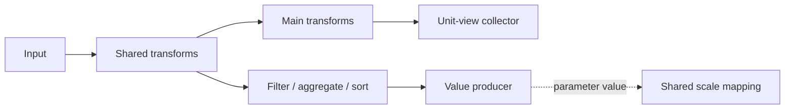

# Transform outputs and dataflow branches

Status: the authorized vertical prototype is implemented, independently reviewed, and verified
on `codex/transform-value-outputs`. The hosted clustered-heatmap example is now
migrated. Named relations, lazy outputs, and output-driven flow scheduling remain
deferred; broader scheduler work and plan retirement require a later increment.

## Recommendation and scope

Make **transform-published parameters** the foundation. A transform can produce
a value while continuing to pass rows downstream. Add a small structural branch
declaration when a summary needs filtering, aggregation, or sorting that should
not change the rows feeding marks. Keep parameter ownership explicit through
the publishing transform's view scope.

The first concrete value producer should project a field into an array, following
Vega's internal `Values` operator. Use it to load precomputed cuts or publish
cuts calculated with existing window/filter transforms. Both feed the already
supported `gapPositions: { expr: "columnCuts" }` interface.

Branching, value publication, and named derived-data publication are separate
capabilities. Design their boundaries together, but do not implement a named
relation registry, general `data()` expression API, incremental tuples, or a new
scheduler merely to publish cuts. The named-data ideas below are future design
constraints, not additional implementation commitments.

This follows [issue #513](https://github.com/genome-spy/genome-spy/issues/513)
more directly than adding a separate `DataParameter` grammar. The initial
heatmap implementation does not by itself close that issue's lazy empty-track
acceptance scenario.

## What Vega actually does

Inspected the local checkout at `tmp/vega/`, commit
`c03b7d0fe369be1a6e81d23dc899aef6eb7da967`:

- **Transform values and row flow are independent.** `Extent.js` updates
  `this.value` and returns no replacement pulse. `vega-dataflow/src/Transform.js`
  then passes the input pulse onward. Publishing an extent needs no branch.
- **The parser connects transform outputs to signals.**
  `vega-parser/src/parsers/transform.js` recognizes `spec.signal` and registers
  `scope.proxy(t)`. `Scope.proxy` creates a `Proxy` operator whose value depends
  on the producer; `Proxy.js` strips row propagation. It is a dependency-backed
  value output, not an unrelated imperative assignment to a global variable.
- **Named derived datasets create branches.** In `parsers/data.js`,
  `source: "upstream"` refers to the existing dataset's output operator. A
  `Relay` connects a new transform pipeline to it. Multiple declarations fan out
  from that shared producer without loading or recomputing the input separately.
  There is no general public `branch` transform in this implementation.
- **Mutation isolation is explicit.** The parser inspects transform metadata;
  `Relay({ derive: true })` creates derived tuples when a branch can modify
  upstream rows. This protects the shared relation.
- **A dataset has separate flow and value interfaces.** `DataScope.js` tracks
  `input`, `output`, and `values`; its terminal `Sieve` exposes backing tuples
  without sending them through value-only dependencies. It also caches shared
  extent/value/index operators. Its internal `Values.js` projects a field from
  an already prepared relation; it does not silently aggregate or deduplicate.
- **Explicit edges supply ordering.** `Operator.parameters` records both pulse
  inputs and operator-value inputs. `dataflow/connect.js`, `rank.js`, and `run.js`
  arrange execution accordingly. The `signal` spelling alone does not provide
  these guarantees.

These paths are under `tmp/vega/packages/`. Representative durable sources:
[transform output parsing](https://github.com/vega/vega/blob/c03b7d0fe369be1a6e81d23dc899aef6eb7da967/packages/vega-parser/src/parsers/transform.js),
[derived pipeline construction](https://github.com/vega/vega/blob/c03b7d0fe369be1a6e81d23dc899aef6eb7da967/packages/vega-parser/src/parsers/data.js),
and [field value projection](https://github.com/vega/vega/blob/c03b7d0fe369be1a6e81d23dc899aef6eb7da967/packages/vega-transforms/src/Values.js).
The local license is BSD-3-Clause, compatible with GenomeSpy's MIT license.
This proposal borrows the design, not source code. Retain provenance and required
notices if implementation later copies or closely adapts code.

## GenomeSpy fit

Architecture entry points: `ARCHITECTURE.md`, Core's
`docs/architecture/views-and-dataflow.md`, and `reactivity.md`.
Paths below are relative to `packages/core/` unless stated otherwise.

- `FlowNode` already supports several children, reset/batch/completion fan-out,
  and scoped runtime providers. Branch topology is already representable.
- `view/flowBuilder.js` currently builds linear transform arrays plus view
  branches and auxiliary join pipelines. A branch declaration belongs in this
  builder; it need not create a runtime branching node.
- `BEHAVIOR_MODIFIES`, `BEHAVIOR_CLONES`, and `BEHAVIOR_COLLECTS`, together with
  `flowOptimizer.js`, already protect shared rows. Preserve those rules at new
  forks, including when a collector replays cached rows.
- Unit views receive terminal collectors automatically. Side paths should not
  acquire a unit-view collector, mark, encoding, picking ID, or scale-domain
  contribution merely because they exist. They may contain explicit `collect`
  transforms when sorting or replay caching is useful.
- Lifecycle ownership currently assumes collectors: `FlowHandle` tracks a main
  collector and auxiliary collectors; `DataFlow.pruneCollectorBranch` and
  `View.dispose` prune them. Value-producing paths need explicit endpoint
  ownership, including a non-unit main path whose children all override its data.
  Generalize endpoint tracking and terminal-branch pruning instead of inserting
  dummy collectors or fake views to satisfy cleanup.
- `SideInputBinding` and the runtime's streaming queue already model revision
  consumption and replay prerequisites. Keep future value/data dependencies
  compatible with this machinery.
- `NamedDataScope` currently binds inline/provider input arrays. It does not
  represent published derived relations. Existing `data.name` is not a declaration
  of a transformation's output.

## Proposed public shape

All syntax in this section is proposed, not currently supported. Names such as
`values` and `branch` are working names; settle their spelling at the API review.

### Value-producing transforms

Declare the output on its producing transform:

```json
{
  "data": {
    "url": "data/column-cuts.csv",
    "format": { "parse": { "cut": "number" } }
  },
  "transform": [{ "type": "values", "field": "cut", "param": "columnCuts" }]
}
```

`values` passes rows onward and publishes an immutable field-value array once
per successfully completed flow result. It preserves order and duplicates;
ordinary transforms prepare the relation and the index scale normalizes cuts.
It accumulates scalar values rather than retaining row objects. Missing/non-scalar
fields fail at the publication boundary with a specification location; the scale
continues to enforce its own numeric/integer cut contract.

Use a shared internal output-binding helper for producer identity, target scope,
readiness, equality, and disposal. Only transforms with a meaningful value output
should expose `param`; do not bolt arbitrary expression callbacks onto every
FlowNode. An eventual `extent` transform can publish `[min, max]`, and a count
producer can publish a number through the same helper. They need no separate
parameter kind and need not change the row stream.

### Side branches

A branch taps the current stream and leaves the main transform cursor intact:

```json
{
  "transform": [
    {
      "type": "branch",
      "transform": [
        { "type": "filter", "expr": "datum.keep" },
        { "type": "values", "field": "position", "param": "positions" }
      ]
    },
    { "type": "formula", "expr": "datum.score * 2", "as": "doubled" }
  ]
}
```

The filter affects the side path. The formula and the unit-view collector receive
all original rows. Branches inherit the declaring view's parameter scope; they
are not synthetic views or additional lexical scopes. A branch can end in a value
producer, including one that emits no rows to another node. Each additional
branch is another declaration; recursion can reuse the same builder when useful.



The builder can connect both child chains to the same input node. It must also
record owned endpoints so load discovery, optimized source sharing, hidden
subtree initialization, and disposal work when a path has no collector. This
includes an unconsumed composition-level main path, not only side branches.
An input-tapping branch with no current input fails clearly.

Allow an optional `branch.data`: supplying `data` starts an independent side
source, just as a child view's `data` overrides inherited input. Without `data`,
the branch taps the current stream; with `data`, it uses that explicit source.
This lets a composition root own both heatmap metadata pipelines without fake
views. Reuse existing source construction and loading. A source-owning branch
is valid even when its owner has no primary input; an input-tapping branch still
requires a current stream. The optional property has a concrete use in this
feature, rather than creating a named-relation system speculatively.

### Producer-owned output declarations

A transform's `param` property declares a read-only output in its view's lexical
scope, following Vega's transform signal model. It does not target an existing
writable parameter. Register local declarations, including nested branches,
before ordinary view expressions bind. Duplicate local names fail; ancestor names
may be shadowed. Outputs start at an immutable empty array, are excluded from
persistence, and retain producer identity/readiness/revision metadata.

The first increment uses root-owned branches for shared-scale outputs. Explicit
outer aliases and named derived relations remain extensions; ordinary expressions
in descendant scopes can already read their ancestor outputs. No new parameter
kind is authored in `params`.

## Authorized vertical prototype

- [x] Implement producer-owned `values` outputs and structural `branch`, including
      an explicit optional `data` source for root-owned metadata pipelines.
- [x] Exercise metadata -> main rows and summary branch -> window/filter/sort ->
      published cuts -> index-scale gaps through the real headless view pipeline.
- [x] Support ordinary-parameter filter replay through an upstream collector;
      verify success, empty output, failure, unchanged values, and disposal.
- [x] Preserve source success and cached-replay publication boundaries. Reject
      unsupported output-dependent flow consumers and unsupported source paths.
- [x] Retain output identity and bound dependency information for future flow
      prerequisites and relation outputs; do not implement those future consumers.
- [x] Add a small local example/docs, inspect actual production-code growth, obtain
      an independent code review, and commit the verified prototype.

The prototype adds `FlowOutput` producer metadata and a successful completion/replay
boundary, compiles branches into ordinary graph children, and records collector-free
endpoints for loading and disposal. Source-result success is preserved separately
from row completion, so failed cached input cannot later publish a successful empty
array. Input guards follow bound identities and validation-only ancestry through
computed, temporal, domain, zoom, authored size, and composition size inputs. They
do not add a new scheduler or per-row dependency walks.

The synthetic example is `examples/docs/grammar/transform/branch-values.json`.
Headless tests verify 18 unchanged main cells while filter replay changes cuts
from `[2, 4]` to `[4]` to `[]`, read-only embedding access, common-ancestor metadata,
shared-source teardown, failed loads/replay, late completion failure, disposal,
shadowing, and operation rebinding. The WebGL smoke check passes. Existing mocked
placement tests now use the real parameter runtime and assert behavior.

Final verification passes: 83 related files (742 tests, one skipped and two todo),
layout/output integration (116 tests), workspace TypeScript, lint, schema builds,
generated documentation consistency, release checks, and WebGL initialization.
Full-suite attempts pass roughly 5000 tests but encounter varying schema timeouts
and worker-startup failures; the affected schema and worker files pass separately.
No timeout allowances or unrelated test infrastructure changes were added.

Independent implementation review approved the prototype after shared-source
teardown, failed-cache replay, and indirect sizing feedback were fixed. The
final delivery reports the parser-based production-line delta for the runtime
implementation, excluding tests, blank lines, and comments.

## Applying it to the clustered heatmap

Implemented in `examples/docs/examples/generic/clustered-heatmap.json` with two
root-owned `branch.data` pipelines. Both shared index scales bind the resulting
outputs. Their root resolution is `excluded` so the title's implicit outer
container cannot take ownership away from the producer scope; descendants still
share the index scales. This remains necessary with the upstream `surround` layout.

Before the surround migration, validated against the original file using its
hosted inputs in normal spec-file
loading context. Both exact cut arrays match, all 4320 matrix cells and 72 gene
labels remain, each annotation/label track retains 60 rows, and equivalent metadata
sources are still shared (23 total data sources before and after). No summary
fields leak into the main rows. Both outputs still load with gene labels and
cell-line annotations hidden. WebGL PNG bytes and SVG geometry match at full
view, zoomed/panned viewports, reset, and resized dimensions. Documentation and
the existing feature Changeset now describe the derived boundaries.

The hosted metadata already contains `column`/`cluster` and `row`/`cluster`.
Their adjacent cluster changes reproduce the present cuts exactly:
x `[29, 36, 41, 46, 53]`, y `[24, 42, 52]`.

In the gene metadata pipeline, use a side branch:

```json
{
  "type": "branch",
  "transform": [
    {
      "type": "window",
      "sort": { "field": "column" },
      "ops": ["lag", "row_number"],
      "fields": ["cluster", null],
      "as": ["previousCluster", "leafRank"]
    },
    {
      "type": "filter",
      "expr": "datum.leafRank > 1 && datum.cluster !== datum.previousCluster"
    },
    { "type": "collect", "sort": { "field": "column" } },
    { "type": "values", "field": "column", "param": "columnCuts" }
  ]
}
```

The main path retains all labels/metadata. Use the same recipe with `row` for
cell lines, retaining all annotation records. `window.sort` determines adjacency
but preserves input propagation order; final `collect.sort` orders the output
array. `A, B, A` yields two cuts, and the first record is omitted by rank rather
than by assuming index zero. Require valid unique leaf indices and cluster labels
in the prepared metadata.

Keep the shared scales at the root and replace their arrays with the existing
ExprRefs. Reverse-y changes visual direction, not group boundary indices. Source
sharing and branch cloning protect the original tables and dendrogram lookups.

Own both side sources at the composition root through `branch.data`: one uses
the existing genes URL and one the existing cell-lines URL, each with its normal
numeric parsing and the corresponding transform list. Declare both targets at
that root. Its shared scales can then bind the names directly, and optional label
visibility does not control whether cuts load. Existing source sharing can merge
equivalent metadata inputs used by child views without merging their transforms.
The outer-alias mechanism remains useful for other examples whose data owner is
a child; it is not needed to make this example's root producers visible.

Precomputed cuts use the same `values` producer after a normal file source. They
need no scale-specific loader or new parameter pipeline grammar.

## Publication and dependency contract

These are the implementation review gates, not optional optimizations:

1. **Separate row flow from value publication.** Rows may stream; the producer's
   current output ref changes only after its completed result is valid. Scalar
   and array outputs share binding/lifetime semantics. Array equality suppresses
   unchanged results without preserving mutable row references.
2. **Use a successful publication boundary for both loading and replay.**
   `UrlSource` completes failed streams before reporting terminal status. An
   encompassing finishing transaction must know the actual outcome before
   releasing staged outputs or allowing observer effects to flush. Inline/named
   sources use successful synchronous return and existing exception reporting.
   `Collector.repropagate()` bypasses source loading, so successful cached replay
   must release candidates too; it cannot rely on source loading-status changes.
   Include ordinary parameter-driven filter/formula replay in this contract.
3. **Readiness remains explicit.** Pending/lazy startup completion is not a
   successful empty result. Reset/loading/failure retain the last successful
   value; successful empty `values` publishes `[]`. Preserve existing coverage,
   stale-request, and disposal protections. Initially support eager URL, inline,
   and named sources plus successful cached collector replay. Reject publisher
   paths with other source kinds, including unsupported sources on side-input
   dependency paths, until their successful publication boundary is integrated.
   Lazy startup and real lazy output do not both pass through URL finishing;
   a generic `complete()` hook cannot certify them. Verify #513's lazy count
   use case separately before expanding that supported set.
4. **Stage output candidates for the active completion/replay boundary.**
   Validate before release, including multiple publishers sharing a source. A
   failed boundary discards its candidates. This does not roll back streamed
   rows or values from earlier successful boundaries. No retries or independent
   async resource state machine are introduced.
5. **Record the actual producer behind each parameter.** Consumers see a stable
   ref with producer ownership/dependency metadata, not an untracked call to
   `setValue`. The producer's ordinary parameter inputs remain explicit. Reject
   feedback into its own producing path, including indirect paths through derived,
   temporal, scale, and visibility-dependent inputs. Existing computed edges do
   not expose every mirror: temporal parameters and displayed scale domains use
   base refs. Preserve their bound input provenance for validation, or reject a
   specific unresolved dependency path with a clear diagnostic. Do not replace
   this with blanket bans on whole expression contexts.
6. **Do not claim downstream dataflow ordering prematurely.** The first cut
   integration needs scale/visual consumers. A flow transform consuming a
   published parameter additionally needs readiness/revision and scheduling
   edges to the producer, compatible with `SideInputBinding` and existing replay
   prerequisites. A side publisher completes after rows have already reached a
   streaming sibling; child-array order cannot fix that. Until explicit ordering
   is implemented and tested, reject such flow consumers rather than use the old
   value or silently reload the entire source. Reserve this dependency capability
   in the output handle; no new scheduler is required now.
7. **Tie teardown to the producer and view owner.** Unsubscribe producer consumers
   before pruning owned endpoints, including unconsumed main paths.
   Shared input sources survive
   while another branch needs them. A queued publisher or in-flight request must
   not update a disposed/replaced target. Rebinding must recheck dependency and
   single-writer constraints before accepting new connections.

This keeps ordinary existing transforms usable in publisher paths. Their file
and facet semantics stay their existing semantics; `values` itself projects the
whole completed flow, including multiple physical batches, and does not silently
restart its array at each file. The heatmap recipe uses one metadata table per
axis and does not depend on cross-file window reduction.

## Future shared derived data

The user's named-output idea is valuable when several views need the same derived
relation. Keep the following design direction open:

- Materialize the relation once with a collector and register an explicit scoped
  output handle: producer identity, collector/data access, revision, readiness,
  lifetime, and dependency information. Consumers attach to that producer through
  graph/relay edges and can apply their own transforms and terminal collectors.
- Declare shared names at their common ancestor so sibling view branches can
  resolve them. Reject duplicate producers and cycles. Do not use view layout
  ancestry as a data dependency or create global names as a convenience.
- Keep tuple-flow output separate from materialized relation access, as Vega's
  `DataScope` does. A future relay can replay the collector without fetching or
  recomputing the upstream source; use normal clone rules for modifying consumers.
- Do not publish derived rows by repeatedly calling the existing host-facing
  `datasets.set()`/`updateNamedData` APIs. Those replace input bindings and can
  trigger loads/replays; they are not producer dependency edges.
- Two possible authoring forms remain open: a branch ending in a `publishData`
  transform, or scoped named pipeline declarations with a Vega-like source
  reference. Prefer the latter for stable reusable named relations if it is
  clearer. Both should reuse the same subpipeline builder and output handles.
  Neither requires exposing row arrays as ordinary parameter values.

Do not implement this registry in the cut feature. Preserve the distinction
between an input binding, a derived relation, and a scalar/array transform value
so a later implementation does not have to undo the initial publisher API.

## Alternatives and key decisions

| Choice                                    | Decision                                                                                       |
| ----------------------------------------- | ---------------------------------------------------------------------------------------------- |
| Parameter-owned `from.data` pipelines     | Discarded: ties a general flow-output capability to a new parameter kind                       |
| Inline pass-through value producer        | Primary primitive; works without a branch for extent/count or a prepared cuts table            |
| Structural `branch` transform declaration | Good fit for local summaries; compiles to existing child chains                                |
| Dedicated runtime branching node          | Unnecessary unless later execution semantics give it a concrete responsibility                 |
| Vega-style named derived pipelines        | Strong future option for cross-view shared relations; not needed for initial parameter outputs |
| Direct scale data reference               | Narrower alternative, but does not supply reusable transform publication                       |
| Specialized cluster-cut transform         | Defer; existing window/filter/collect expresses the intended adjacency contract                |

## Implementation milestones

### 1. Establish transform value publication

Outcome: a pass-through `values` producer publishes a field array to its own scoped
parameter; precomputed-file cuts drive an existing shared index scale.

Affected areas: `src/spec/transform.d.ts`, transform factory/new values transform,
output preflight at hierarchy finalization, scoped parameter binding and embedding
API ownership under `src/paramRuntime/`, successful source/collector-replay
publication boundaries, endpoint ownership/pruning for collector-free main
publishers, and App parameter/provenance consumers. Read descendant
instructions before editing those packages. Do not change renderer algorithms.

Verification: real spec-to-flow-to-scale tests for row pass-through, scope/outer
aliases, declaration order, equality, empty success, failed URL load, stale load,
reactive collector replay, multiple writers, projection failure across shared
sources, immutable/read-only API results, unconsumed composition-level main
publishers, unsupported source paths, and disposal. Cover direct and indirect
feedback and explicit rejection of unsupported flow consumers. Reuse existing
source/runtime tests instead of reproducing their entire matrices.

Docs/migration: use `write-genomespy-docs` for output syntax, scope, initial values,
readiness, and consumer limits; regenerate schema and add a local cuts example.
Use `write-genomespy-changeset` for a Core minor release note. Existing specs keep
working. Review any added runtime metadata against the simpler target contract.

Tentative commit: `feat(core): publish transform values as scoped parameters`

Review gate: public producer/target contract, successful completion and replay,
feedback detection, and downstream App/scale consumers.

### 2. Add side pipelines and derive both heatmap cut arrays

Outcome: ordinary transforms in a side path prepare an array without filtering
or mutating the main mark data. Both heatmap axes derive their current cuts.

Affected areas: branch spec/builder, extending endpoint ownership/source discovery
to side paths, optimizer clone behavior, the shared heatmap example,
and its docs. Root-owned `branch.data` gives the two heatmap publishers explicit
ownership independent of child visibility. Named relation publication stays deferred.

Verification: fork pass-through, no main/side mutation leakage, explicit side
collectors, publisher-only terminals, owner without a primary source, shared-source pruning, visibility activation, and reactive replay.
Exercise shuffled/nonzero-start/repeated-label/empty metadata. Verify the exact
hosted arrays and use `test-genomespy-views` for representative SVG alignment.

Docs/migration: explain branch scope and main-path semantics; update the heatmap
page and local example. Reuse the feature Changeset. Measure builder/runtime
size before and after and simplify duplicated pipeline construction paths.

Tentative commit: `feat(core): support side transform pipelines`

## Final integration and acceptance

- [x] The same value-output contract supports precomputed-file cuts and cuts
      derived from metadata; no new parameter kind or scale loader is required.
- [x] Rows on the main path remain complete and unmodified by the summary path.
      Only unit-view main collectors feed marks; side collectors are explicit.
- [x] Root scope and visibility placement are concrete for both axis producers.
      The example yields x `[29, 36, 41, 46, 53]` and y `[24, 42, 52]`.
- [ ] Pan, zoom, reset, reverse-y, resize, dendrogram offsets and viewport height
      fitting retain alignment; `scaleGroups` and pointer inversion follow gaps.
- [x] Source completion and cached replay share successful value publication;
      pending startup/failure cannot masquerade as successfully empty output.
- [x] Producer dependencies, unsupported flow-consumer diagnostics, indirect
      feedback, writer ownership, rebinding and disposal are verified.
- [ ] Run focused Vitest suites with `--reporter=agent`, applicable TypeScript,
      lint, schema/example and docs checks. Use `debug-genomespy-web` to exercise
      the actual heatmap and local file example in WebGL and SVG; check WebGPU
      where supported. Broaden tests only when shared-contract changes warrant it.
- [ ] Independently review the final cross-subsystem integration, simplify
      overlapping tests, and follow the plan retirement workflow before a PR.

## Remaining design questions

- The prototype exposes `values`/`param` and `branch`; review the names before release.
- What is the smallest output dependency representation that preserves semantic
  ancestry through existing temporal/domain mirrors and later relation handles?
  Inspect current binding metadata; do not import Vega's entire operator runtime.
- Which downstream flow-consumer case first justifies implementing explicit
  producer prerequisites? It is not necessary for these gap expressions.

## Review and planning verification

The previous review's recommendation for parameter-owned pipelines is superseded.
Its useful lifecycle findings remain incorporated: source completion can represent
failure; collector replay bypasses source loads; mirrored refs can hide ancestry;
shared-source outputs and disposal need explicit ownership.

The subagent inspected the actual local Vega implementation and reviewed this
rewritten proposal. Its material findings are incorporated:

- Track collector-free main endpoints as well as side endpoints, starting in
  milestone 1, so a composition-level inline publisher cannot leak its source.
- Reserve producer-owned declarations before local ordinary expressions bind;
  revalidate bound consumers before mutable operation or mirror inputs change.
- Root-owned `branch.data` sources settle heatmap scope and visibility ownership.
- Explicitly bound initial source support; lazy completion has different success
  paths and cannot inherit the eager URL finishing contract automatically.

The reviewer found no additional proposal blocker with these decisions. Keep
semantic input provenance limited to validation rather than another scheduler.

Previously executed the proposed window/lag/row_number/filter/collect recipe with
GenomeSpy's existing transforms against the downloaded hosted CSVs: both exact
arrays matched for original and reversed input; repeated labels, nonzero starts,
a single cluster, and empty input also passed. Also executed a real FlowNode fork
with main-path formula and side-path window/filter/collect transforms through the
existing optimizer: all main rows remained present, original input was unchanged,
and both child orders produced the same A/B/A cuts. The prototype now implements
the grammar and verifies the synthetic pipeline through headless and WebGL paths.
